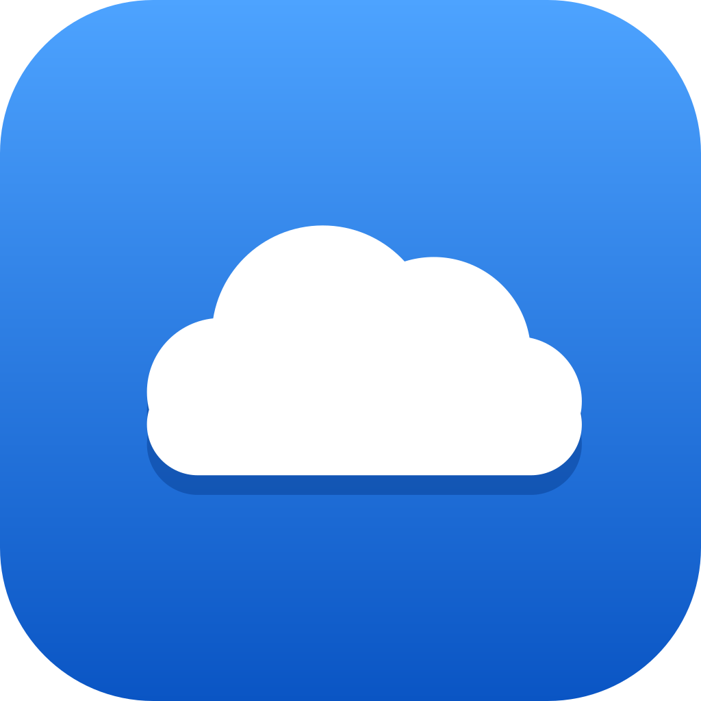
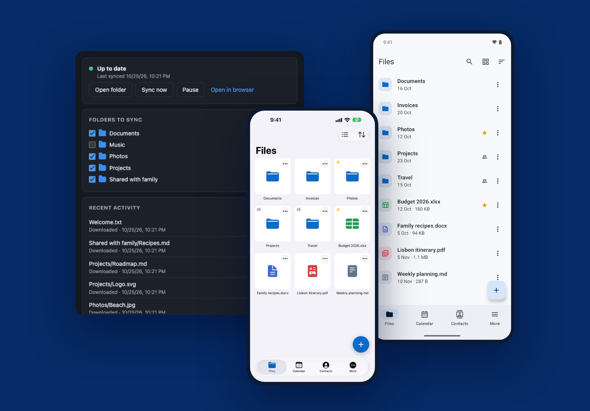
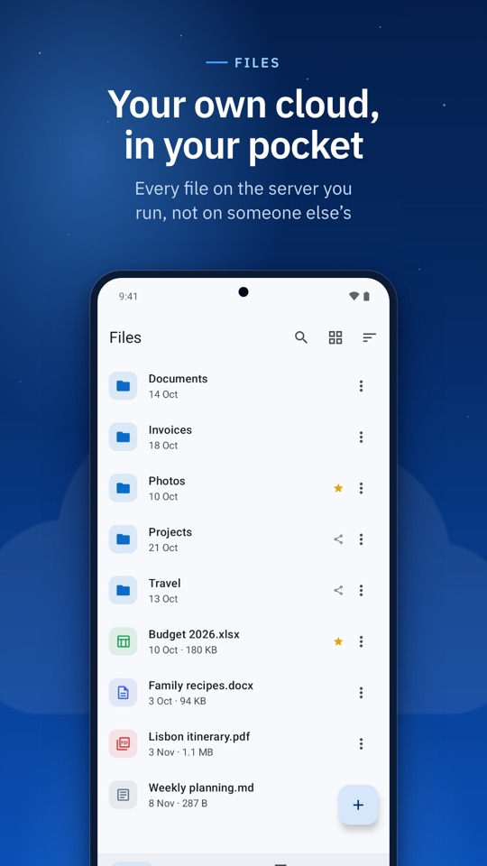
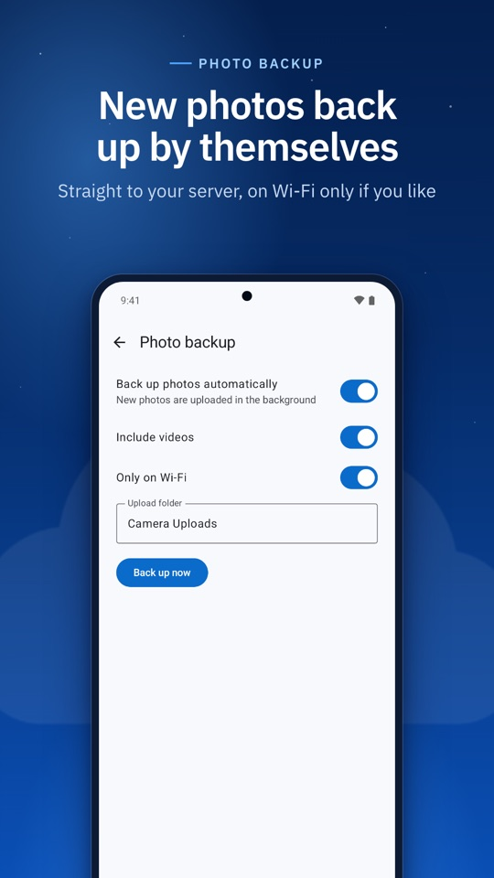
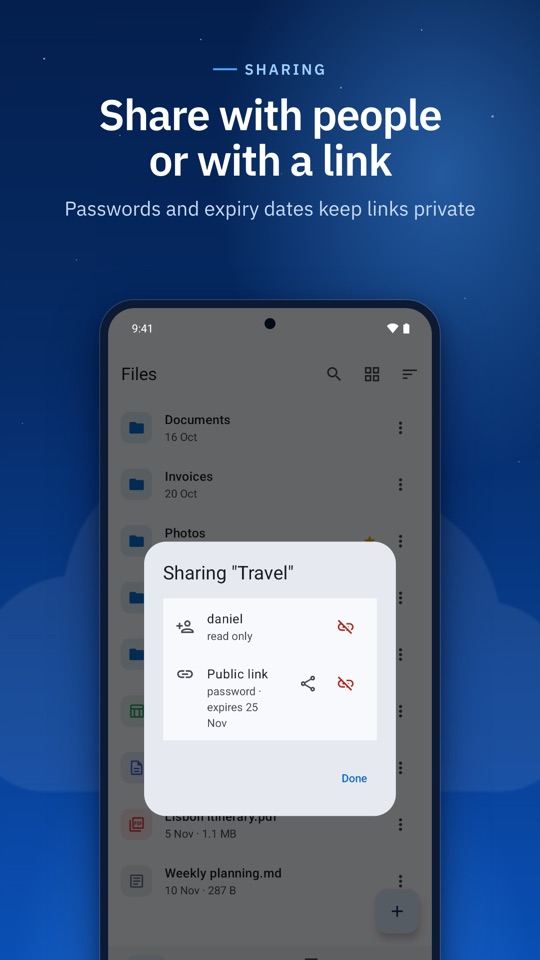
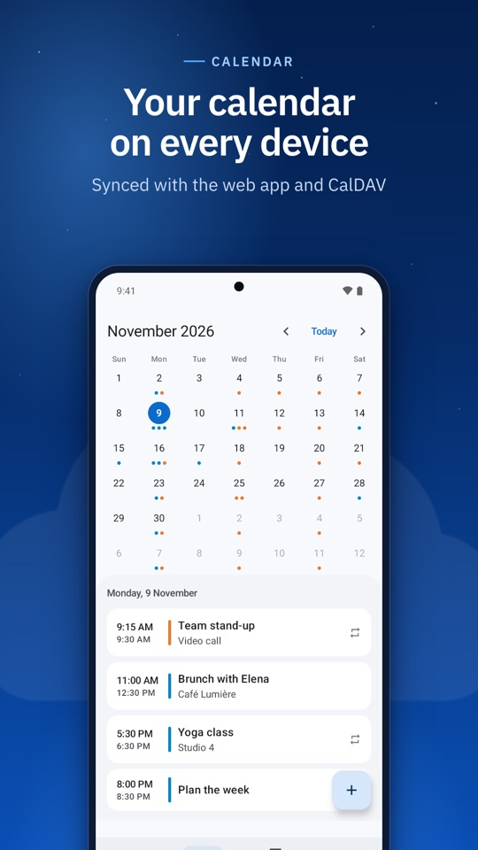

<p align="center"></p>

<h1 align="center">Cloudy</h1>

<p align="center">A cloud you host yourself.<br>Files, sharing, calendars and contacts on your own server, with apps for your phone and your computer.</p>

<p align="center">
  <a href="CHANGELOG.md"></a>
  <a href="https://github.com/Fahed-Alhammadi/Cloudy/releases/latest"></a>
  <a href="https://testflight.apple.com/join/X1M6sYZm"></a>
  <a href="https://github.com/Fahed-Alhammadi/Cloudy/actions/workflows/server.yml"></a>
  <a href="LICENSE"></a>
</p>

<p align="center">
  <a href="https://play.google.com/store/apps/details?id=io.cloudy.app&hl=en"></a>
</p>

<p align="center">
  <a href="https://fahed-alhammadi.github.io/Cloudy/">Website</a> ·
  <a href="#install">Install</a> ·
  <a href="CHANGELOG.md">What's new</a> ·
  <a href="Website/ARCHITECTURE.md">How it works</a> ·
  <a href="https://fahed-alhammadi.github.io/Cloudy/support.html">Support</a>
</p>

<p align="center"></p>

## Why Cloudy

- **Your server, your data.** One container with the database, the web app and office previews inside. Your files
  never pass through anyone else's servers.
- **Every device.** Web app, Android, iPhone, and a sync app for Mac, Windows and Linux. Changes show up everywhere
  within seconds.
- **More than files.** Calendars, contacts, photo backup, document scanning and sharing links, in one place.
- **Works with the apps you have.** WebDAV, CalDAV and CardDAV for Finder, Windows Explorer, rclone, Thunderbird,
  DAVx⁵ and Apple Calendar and Contacts.
- **No ads, no analytics, no tracking.** Free and open source under the MIT License.

## Apps

| App | What it does | Get it |
|---|---|---|
| Web | Files, sharing, calendar, contacts, administration | Built into every server |
| Android (phones and tablets) | Files, offline files, photo backup, document scanner, calendar, contacts | <a href="https://play.google.com/store/apps/details?id=io.cloudy.app&hl=en"></a> |
| iPhone | Files with Quick Look, "Share to Cloudy" from any app, document scanner, sharing, calendar, contacts, Face ID lock | Beta: [join on TestFlight](https://testflight.apple.com/join/X1M6sYZm) (App Store soon) |
| Mac, Windows, Linux | Keeps a folder on your computer in sync with your files | [Releases page](https://github.com/Fahed-Alhammadi/Cloudy/releases/latest) |
| Other apps | WebDAV, CalDAV, CardDAV | Finder, Windows Explorer, rclone, Thunderbird, DAVx⁵, Apple Calendar and Contacts |

### Android app

<p align="center">
  
  
  
  
</p>

<p align="center"><a href="https://play.google.com/store/apps/details?id=io.cloudy.app&hl=en"></a></p>

Install Cloudy from [Google Play](https://play.google.com/store/apps/details?id=io.cloudy.app&hl=en), then sign in
with your server's address, your username and your password. It runs on Android 8 or newer, on phones and tablets.

### Desktop app

Download from the [releases page](https://github.com/Fahed-Alhammadi/Cloudy/releases/latest): `.dmg` (Apple silicon
`arm64` or Intel `x64`) or `.pkg` (all Macs), `.exe` (Windows), `.AppImage` or `.deb` (Linux). The Mac app is signed
and notarized by Apple, so it opens without warnings. The Windows installer isn't signed yet: Windows may show
"Unknown publisher" the first time; choose "More info" → "Run anyway". The app updates itself.

More about each app: [Android](android/README.md) · [iPhone](ios/README.md) · [Desktop](desktop/README.md).

## Features

- **Files:** drag-and-drop upload (whole folders too), resumable uploads, previews for images, video, audio and
  PDF, a text editor, versions, trash, favorites, recent files, search, and download a folder as ZIP.
- **Sharing:** with users or groups, read-only or editable; public links with a password, an expiry date, and
  optional upload into the shared folder.
- **Desktop sync:** pick which folders to sync; changes go up and down within seconds; renames and moves aren't
  transferred again; edits in two places keep both copies; deletions go to the trash. It runs in the menu bar or
  system tray.
- **Phone apps:** browse, preview and share files, send them to other apps and receive files from any app's share
  sheet ("Share to Cloudy"), scan documents to PDF, calendar and
  contacts, text editing, app lock. On Android you also get offline files and automatic photo backup.
- **Live updates:** file lists in the browser, the phone apps and the desktop app update by themselves when files
  change anywhere (another device, a share, WebDAV).
- **Office documents:** Word, Excel, PowerPoint and OpenDocument files can be viewed (read-only) in the browser
  and the apps. The built-in LibreOffice turns them into PDF, inside the same container.
- **Calendar and contacts:** web apps plus CalDAV/CardDAV sync. Import contacts from `.vcf` (vCard 2.1–4.0) or
  `.csv` (Google, Outlook), skipping duplicates, and export an address book as one `.vcf`.
- **Security:** passkey sign-in, two-factor authentication (authenticator-app codes + recovery codes), an app
  password per device that you can revoke, and brute-force protection.
- **Email:** password reset by email, share notifications and security notices through your SMTP server.
- **Administration:** users, groups, quotas, app passwords, 2FA and passkey reset, and email (SMTP) settings.
- **Languages:** English, العربية, Deutsch, Français, Español on the web, the apps and in emails.

## Install

You need Docker with the Compose plugin. Three steps:

```sh
# 1. Get the compose file
mkdir cloudy && cd cloudy
curl -fsSLO https://raw.githubusercontent.com/Fahed-Alhammadi/Cloudy/main/docker-compose.yml

# 2. Set the admin password (and anything else you want to change)
nano docker-compose.yml        # ADMIN_PASSWORD: ${ADMIN_PASSWORD:-your-password-here}

# 3. Start
docker compose up -d
```

Open http://localhost:8080 (or `http://<server-ip>:8080`) and sign in as `admin` with your password.

Every setting is in `docker-compose.yml` with its default, written as `${NAME:-default}`. To change one, edit
the part after `:-`. For example, to store files on your NFS mount and use port 9000:

```yaml
      - "${APP_BIND:-0.0.0.0}:${APP_PORT:-9000}:8080"
      - ${DATA_PATH:-/mnt/cloudy}:/data
```

If you'd rather not touch the compose file, put the same names in a `.env` file next to it (see
[`.env.example`](.env.example)). Values in `.env` override the defaults in the file.

If you leave `ADMIN_PASSWORD` empty, a random password is generated on first start. Read it with
`docker logs cloudy | grep "admin password"`.

**Just trying it out?** One command, no files needed:

```sh
docker run -d --name cloudy -p 8080:8080 \
  -v cloudy-data:/data -v cloudy-db:/var/lib/cloudy/db \
  ghcr.io/fahed-alhammadi/cloudy:latest
docker logs cloudy | grep "admin password"
```

The image contains Cloudy and its own PostgreSQL 17. The database is reachable only inside the container
(no network port, no password to manage). Set `DATABASE_URL` to use an external PostgreSQL instead.

**Build from source instead** (development or your own changes), from a clone of this repository:

```sh
docker compose -f deploy/docker-compose.yml --env-file .env up -d --build
```

Both compose files use the same project name and volumes, so switching between them keeps your data.

## Production

Cloudy serves plain HTTP on `APP_PORT` (default 8080). Put it behind your reverse proxy for TLS, and set
`TRUST_PROXY` to `true`. The proxy must:
- forward `Host`, `X-Forwarded-For` and `X-Forwarded-Proto`;
- allow unlimited request bodies and long timeouts (uploads arrive in 8 MB chunks; downloads stream);
- pass all HTTP methods through (WebDAV uses PROPFIND, MKCOL, MOVE, COPY, LOCK, REPORT…).

Set `APP_BIND` to `127.0.0.1` if the proxy runs on the same host.

Example nginx location:

```nginx
location / {
    proxy_pass http://127.0.0.1:8080;
    proxy_set_header Host $host;
    proxy_set_header X-Forwarded-For $proxy_add_x_forwarded_for;
    proxy_set_header X-Forwarded-Proto $scheme;
    client_max_body_size 0;
    proxy_request_buffering off;
    proxy_buffering off;
    proxy_read_timeout 3600s;
}
```

**Back up** the database (`DB_PATH`) and the user files (`DATA_PATH`) together. For a consistent database dump
while Cloudy runs:

```sh
docker exec -u node cloudy pg_dump -h /run/cloudy -U cloudy cloudy > cloudy.sql
```

(Use your `APP_USER` uid instead of `node` if you changed it.)

### Storing files on NFS or another disk

User files live wherever `DATA_PATH` points. That folder holds uploads in progress, versions and trash
too, so everything moves together. To use an NFS share:

1. Mount the share on the host, e.g. `/mnt/cloudy` (add it to `/etc/fstab` so it mounts before Docker
   starts).
2. Make it writable by the user Cloudy runs as: `sudo chown 1000:1000 /mnt/cloudy`, or match the NFS
   export's owner with `APP_USER`.
3. Set `DATA_PATH` to `/mnt/cloudy` (and `APP_USER` if the owner isn't 1000:1000), in `docker-compose.yml`
   or `.env`. Keep `DB_PATH` (the database) on a local disk; databases on NFS risk corruption.
4. Run `docker compose up -d`.

If the folder isn't writable, the app refuses to start and logs exactly which uid:gid needs access.
Moving an existing install: stop the stack, copy the contents of the old storage (for the default volume:
`docker run --rm -v cloudy_app-data:/from -v /mnt/cloudy:/to alpine cp -a /from/. /to/`), set
`DATA_PATH`, and start again.

## Updates

**Server.** `docker-compose.yml` runs `ghcr.io/fahed-alhammadi/cloudy:latest`. To update to the newest
release, run this in the folder with your `docker-compose.yml`:

```sh
docker compose pull && docker compose up -d
```

The database schema migrates itself at startup. Your data stays in the volumes. What changed in each server
version, and anything you need to do before updating, is in [CHANGELOG.md](CHANGELOG.md).

**Apps.** Android and iPhone update through Google Play and the App Store (TestFlight for the beta). The desktop app
checks GitHub once a day for a new version and downloads it in the background. On a Mac it's installed when you
restart or quit Cloudy; on Windows and Linux choose *Restart to update* in the menu (*Settings → Check for updates*
checks right away).

## Two-factor authentication

Each user can turn it on under *Settings → Two-factor authentication*:
1. Scan the QR code with an authenticator app (Google Authenticator, Microsoft Authenticator, Authy, 1Password…).
2. Confirm with a code.
3. Save the 10 recovery codes shown.

From then on, the web app and the apps ask for a code after the password. A recovery code can be used
once instead, if the phone is lost.

With 2FA on, WebDAV, CalDAV and CardDAV apps must sign in with an **app password**, because those protocols
can't ask for a code. An administrator can reset 2FA for a user under *Administration → Edit user*.

## Office documents

Opening a `.docx`, `.xlsx`, `.pptx`, `.odt`, `.ods`, `.odp`, `.rtf` (or older `.doc`/`.xls`/`.ppt`) file shows a
read-only preview in the browser and in the apps. The built-in LibreOffice converts the document to PDF the
first time it's opened (usually a second or two) and keeps the result until the file changes. To change a
document, download it and upload the new version — Cloudy keeps the old one under *Versions*.

Text files (`.txt`, `.md`, `.csv`, …) can be edited directly in the browser and the phone apps.

## Email

Set up an SMTP server under *Administration → Email (SMTP)* (server, port, encryption, login, sender) and use
*Save and send test* to check it. Cloudy then:
- shows **Forgot password?** on the login page (web and Android): the user enters their username or email and
  gets a one-time link, valid 60 minutes, to choose a new password. The answer never reveals whether an account
  exists, and requests are rate-limited. A reset signs the account out everywhere;
- emails users when a file or folder is shared with them (each user can turn this off under *Settings → Profile*);
- sends a security notice when a password is changed.

Emails go to the address in each user's profile. Leave the SMTP server empty to turn email off. The SMTP password
is stored in the database and never shown again in the web UI.

Links in emails point at `PUBLIC_URL`, or, when that isn't set, at the address you were using when you saved the
email settings (never at whatever address a request came in on). Set one of them, or password reset emails are
not sent.

## Passkeys

Users add a passkey under *Settings → Passkeys* (confirming with their password). After that they can sign in to
the web app with *Sign in with a passkey*, or by picking the passkey from the username field's autofill. No
username, password or two-factor code is needed: the passkey itself requires the device's PIN or biometrics.

- Passkeys need HTTPS (or `http://localhost`) and only work on the address they were created on. If your
  proxy doesn't forward the original `Host`, set `PUBLIC_URL` (e.g. `https://cloud.example.com`).
- The password still works, and the apps and DAV clients keep using passwords / app passwords.
- An administrator can remove all of a user's passkeys under *Administration → Edit user*.

## Connecting other apps

Create an app password under *Settings → Connect apps and devices*, then use:

| Client | Address |
|---|---|
| WebDAV (Finder, Explorer, rclone, Cyberduck) | `https://<host>/dav/files/<username>/` |
| CalDAV / CardDAV (Thunderbird, DAVx⁵, Apple) | `https://<host>/dav/` (auto-discovered via `/.well-known/caldav` and `/.well-known/carddav`) |

## Configuration

Set these in `docker-compose.yml` (the value after `:-`) or in a `.env` file next to it.

| Variable | Default | Purpose |
|---|---|---|
| `ADMIN_USER` / `ADMIN_PASSWORD` | `admin` / random | First administrator (created on first start) |
| `APP_PORT` / `APP_BIND` | `8080` / `0.0.0.0` | Published port and interface |
| `APP_USER` | `1000:1000` | uid:gid the server runs as |
| `DATA_PATH` | `app-data` (volume) | Where user files are stored: a volume name or a host folder |
| `DB_PATH` | `db-data` (volume) | Where the built-in database is stored (local disk) |
| `DATABASE_URL` | built-in | External PostgreSQL instead of the built-in one |
| `TRUST_PROXY` | `false` | Honor `X-Forwarded-*` headers (only behind a proxy) |
| `TRASH_RETENTION_DAYS` | `30` | Days before trashed items are deleted |
| `MAX_VERSIONS` | `20` | Versions kept per file |
| `SESSION_DAYS` | `14` | How long a browser login lasts |

## Development

| Task | Command |
|---|---|
| Type-check the server | `cd server && npm install && npm run typecheck` |
| End-to-end tests (stack running) | `python3 tests/e2e.py http://localhost:8080 admin '<admin password>'` |
| Android debug build | `cd android && ./gradlew assembleDebug` (JDK 17+, Android SDK 36) |
| iOS simulator build | `ios/build.sh` (Xcode 16+, `brew install xcodegen`) |
| Desktop app | `cd desktop && npm install && npm start` (tests and packages: [desktop/README.md](desktop/README.md)) |
| Translations complete | `python3 tests/i18n_check.py` |

See [Website/ARCHITECTURE.md](Website/ARCHITECTURE.md) for how Cloudy works inside.

## Project layout

```
server/              server (Node.js/TypeScript) + HTML5 web app (server/public) → Docker image (CHANGELOG.md)
android/             native Android app (Kotlin, Jetpack Compose) → Google Play
ios/                 native iPhone app (Swift, SwiftUI) → App Store
desktop/             desktop sync app (Electron, TypeScript) → GitHub releases
deploy/              docker-compose.yml that builds the image from source
Website/             website (screenshots), privacy policy, architecture notes
tests/               end-to-end API/WebDAV/CalDAV/CardDAV tests, translation check
scripts/             versions and release helpers
.github/workflows/   one workflow per product (test and build; a tag such as ios-X.Y.Z publishes), translations.yml
```

## Support

Questions and bug reports: [GitHub Issues](https://github.com/Fahed-Alhammadi/Cloudy/issues). Please don't include
passwords, server addresses or personal files. More help: [support page](https://fahed-alhammadi.github.io/Cloudy/support.html).

Found a security problem? Please report it privately, not as an issue: see [SECURITY.md](SECURITY.md).

## License

Cloudy is released under the [MIT License](LICENSE). © 2026 Fahed Alhammadi

The website uses the [IBM Plex](https://github.com/IBM/plex) fonts, licensed under the
[SIL Open Font License 1.1](https://openfontlicense.org). Dependencies keep their own licenses (see the
`package-lock.json` files and the apps' build files).

Google Play and the Google Play logo are trademarks of Google LLC.

© 2026 Fahed Alhammadi. All rights reserved.
